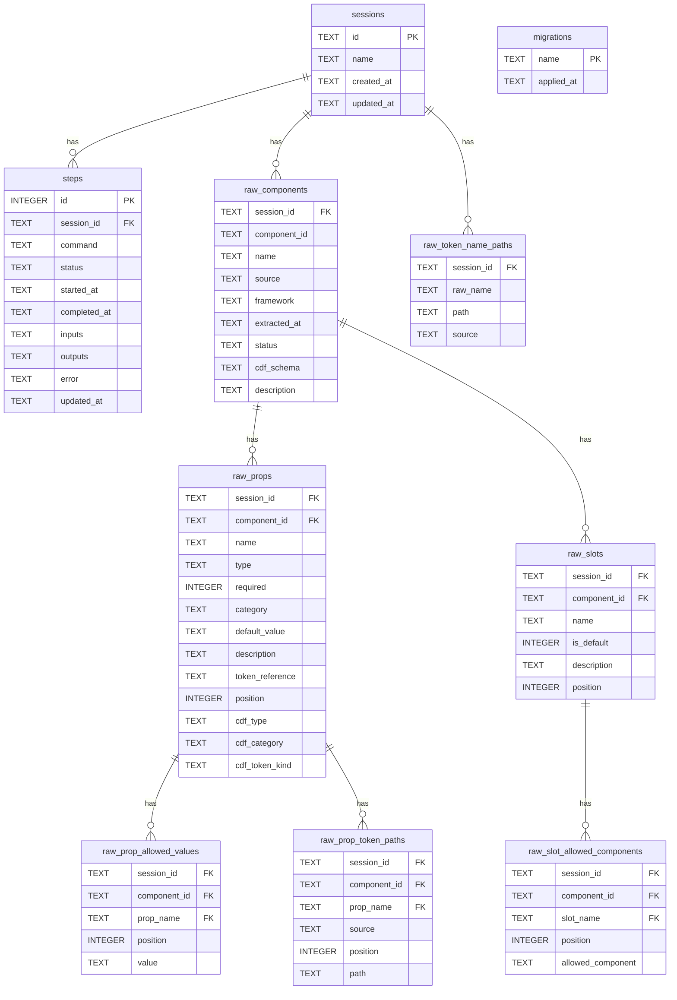
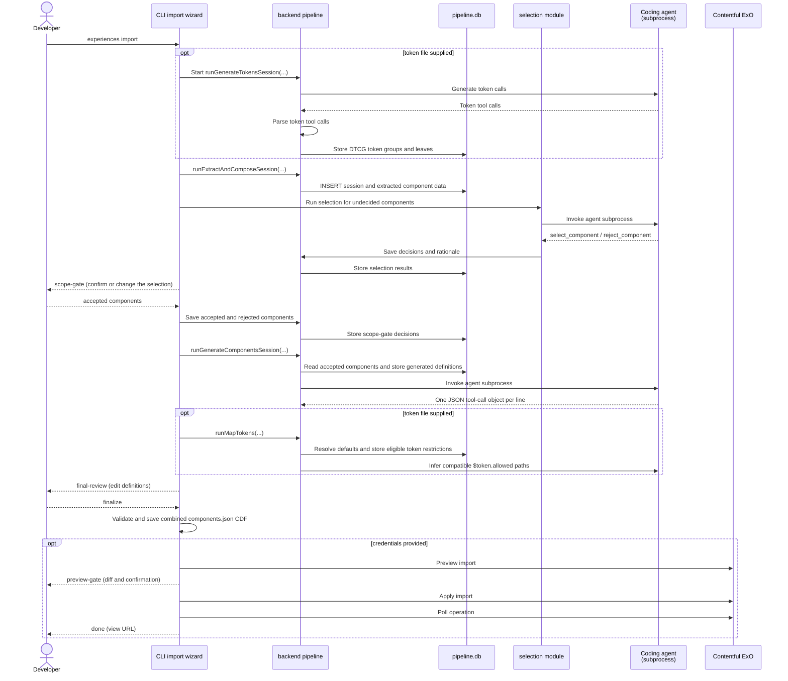

# Architecture

## Overview

The Experience Design System SDK is an Nx monorepo with six packages:

| Package                                                | Purpose |
| ------------------------------------------------------ | ------- |
| `@contentful/experience-design-system-cli`             | Published CLI and interactive import wizard; owns user input, screens, and flow routing |
| `@contentful/experience-design-system-backend-pipeline` | In-process extraction, generation, session persistence, validation, and apply operations called by the wizard |
| `@contentful/experience-design-system-extraction`      | Component extraction engine with TypeScript and framework parsers; used by the backend pipeline |
| `@contentful/experience-design-system-generation`      | Source skill files copied into the CLI package as runtime assets |
| `@contentful/experience-design-system-client`          | Generated API client used by backend apply operations |
| `@contentful/experience-design-system-types`           | Shared TypeScript types, Zod schemas, and CDF/DTCG validation logic |

The supported user flow is the interactive `experiences import` wizard. The CLI calls backend-pipeline functions directly in the same process; the backend invokes the selected coding agent as a local subprocess where needed.

---

## System Context

```
Design system codebase
  (React / Vue / Astro / Stencil / Web Components)
        │
        ▼
  experiences import (CLI TUI)
    ├── collects project, token, agent, and credential inputs
    ├── calls backend-pipeline extraction, generation, validation, and apply functions in-process
    ├── invokes the selected coding agent as a subprocess for agent-backed stages
    └── reviews and saves the generated CDF before preview and push
        │
        ▼
  Contentful ExO (component types + design tokens)
```

Component-analysis data between stages flows through a local SQLite session database (`~/.contentful/experience-design-system-cli/pipeline.db`). When a token source is supplied, the wizard starts token generation alongside extraction and selection, then maps tokens after component generation where eligible. The same import flow validates the saved CDF and handles preview and push; these are not separate CLI commands.

Raw prop definitions retain optional DOM-forwarding provenance in the session database: true, false, or unknown. Selection and component generation derive advisory prop buckets from that evidence, then omit the provenance flag from raw component data in agent prompts; the buckets are context rather than inclusion or category decisions.

With Debug Mode enabled, the CLI records `prop-buckets.select` and `prop-buckets.generate` events in `.contentful/<session>/debug/events.jsonl`, including the pipeline session ID. The backend accepts optional caller-owned event sinks; it does not own a log file. Generation waits for these diagnostic writes on success and failure, and disabled or failed debug logging does not stop the import.

A separate JSON file at `~/.contentful/experience-design-system-cli/state/runs.json` records each successful wizard session (id, project path, save path, push target, component count). No command lists these records.

When a token file is supplied (the token-input screen), the wizard starts token generation alongside extraction and selection. Token mapping runs after component generation and uses the generated CDF and DTCG data from their pipeline sessions.

---

## Packages

### `experience-design-system-cli`

The published package provides the `experiences`, `exo`, and `experience-design-system-cli` binaries. The CLI owns the Ink import wizard under `src/tui/import/`, registers the `import` route, and calls backend-pipeline operations directly. Its `copy-assets` target copies the generation package's skills into the published package for runtime prompt loading.

### `experience-design-system-backend-pipeline`

Owns extraction and composition orchestration, generation sessions, prompt assembly, session persistence, in-process validation, and apply operations. The CLI imports these functions instead of spawning hidden CLI commands. Matching skill files under `src/agents/skills/` provide fallback content for backend prompt loading.

### `experience-design-system-extraction`

Component extraction engine: per-framework parsers (React, Vue, Astro, Stencil, Web Components) built on ts-morph, plus prop pre-classification. Consumed by the backend pipeline.

### `experience-design-system-generation`

Owns the primary generation and selection skill markdown sources. The CLI build copies these files into its package; the backend pipeline also carries fallback skill copies for direct prompt loading.

### `experience-design-system-client`

Generated TypeScript client for the Experience Design System Integrations API, generated from `openapi.json` via `@hey-api/openapi-ts`. Consumed by backend apply operations for preview and apply requests.

### `experience-design-system-types`

CDF and DTCG type definitions, JSON schemas, and validation utilities. Published as a separate package and consumed by the CLI and backend pipeline.

---

## Data Formats

### RawComponentDefinition (extraction output)

Produced by extraction, stored in the pipeline session database, consumed by the wizard's scope-gate and internal generation:

```typescript
interface RawComponentDefinition {
  name: string; // PascalCase component name
  source: string; // absolute path to source file
  framework: "react" | "next" | "vue" | "astro" | "web-component" | "stencil";
  props: RawPropDefinition[];
  slots: RawSlotDefinition[];
}

interface RawPropDefinition {
  name: string;
  type: string; // TypeScript type string
  required: boolean;
  category?: "content" | "design" | "state";
  defaultValue?: string;
  allowedValues?: string[]; // for enum / union types
  description?: string;
  tokenReference?: string; // e.g. "color.brand.primary"
}

interface RawSlotDefinition {
  name: string;
  isDefault: boolean; // true = children slot
  description?: string;
  allowedComponents?: string[];
}
```

### CDF (Component Definition Format)

The finalized format for Contentful ExO import. Produced by backend generation and reviewed and saved by the import wizard:

```typescript
interface CDFFile {
  $schema: string;
  [key: string]: CDFGroupOrComponent | string | undefined;
}

interface CDFComponentEntry {
  $type: "component";
  $description?: string;
  $properties: Record<string, CDFPropertyDefinition>;
  $slots?: Record<string, CDFSlotDefinition>;
}

interface CDFPropertyDefinition {
  $type: CDFPropertyType; // 'string' | 'richtext' | 'number' | 'media' | 'link' | 'enum' | 'token' | 'boolean'
  $category: CDFPropertyCategory; // 'content' | 'design' | 'state'
  $description?: string;
  $required?: boolean;
  $default?: unknown;
  $values?: string[];
  "$token.kind"?: string;
  "$token.allowed"?: string[]; // restricted DTCG paths; omitted for unrestricted token props
}
```

For design-category token properties, extraction stores the raw default in `raw_props.default_value` and does not rewrite it during mapping. `map tokens` resolves `tokenReference` when present, otherwise the raw default, to a canonical DTCG path when it is exact or has one token-kind-compatible normalized terminal-member match. It persists that source-reference-to-path association in `raw_token_name_paths`. When CDF is projected, that compatible path becomes `$default`; otherwise the raw extracted default is retained. The agentic part of the stage is separate: it may write reviewed-compatible DTCG paths to `$token.allowed`, while an empty or absent restriction leaves the property unrestricted.

### DTCG (W3C Design Token Format)

Design token files following the W3C DTCG spec. Produced by backend token generation and used by the import wizard's mapping and apply flow:

```typescript
interface DTCGTokenLeaf {
  $type: string;
  $value: unknown;
  $description?: string;
}

interface DTCGTokenGroupNode {
  $description?: string;
  [key: string]: DTCGTokenNode | string | undefined;
}
```

---

## Pipeline Session Database

All import stages share a single SQLite database at `~/.contentful/experience-design-system-cli/pipeline.db` (overridable via `EDS_PIPELINE_DB_PATH`). Legacy `import.db` data may be read once by session migration, but the current apply flow uses the sources API manifest operation rather than per-entity push resumption.

Database initialization also runs a one-time cleanup migration for obsolete step labels. It removes only `analyze select`, `print components`, `print tokens`, and `fetch existing entities` rows whose status is `pending`, `failed`, or `interrupted`; completed rows, retained workflow labels, unknown labels and statuses, sessions, and saved component/token data remain intact.

`DatabaseSync` (Node.js built-in) is used throughout. Synchronous writes are safe from SIGINT and uncaught exceptions without async ceremony — the database is always consistent at the moment of a signal.

Sessions are created by extraction; the wizard passes the session ID to later in-process backend operations.

### pipeline.db — Entity Relationship Diagram



`raw_components.status` progresses from `'extracted'` (written by extraction) to `'generated'` (updated by the import wizard's internal generation stage after AI processing). The `cdf_*` columns on `raw_props` and the `description` column on `raw_components` are null until internal generation runs.

`raw_prop_token_paths` is the ordered session sidecar for token-property path lists used for `$token.allowed`. Its `source` is `agent` or `review`; review decisions take precedence over later agent suggestions. The separate `raw_token_name_paths` sidecar stores automatic or manual mappings from an extracted source reference to a canonical DTCG path. These sidecars preserve raw extraction while supporting the CDF projection described above.

### Pipeline Data Flow — Sequence Diagram



---

## React Extractor Architecture

The React extractor (`packages/experience-design-system-extraction/src/extract/react.ts`) is the most complex component (~2500 lines). It uses ts-morph to walk the TypeScript AST of each `.tsx`/`.jsx` file.

### Extraction pipeline per file

```
Source file
  ↓
Find exported PascalCase declarations
  ↓
resolvePropsType()
  → unwraps FC<P>, forwardRef<Ref, P>, PropsWithChildren<P>
  → follows type aliases to their declaration
  ↓
extractPropsFromType()
  ├── isPureExpandableDomAttributeWrapperType?
  │     → getSyntheticDomAttributeProps() (curated list)
  ├── shouldMergeDomSyntaxExtraction?
  │     → syntax path only (intersection with DOM wrapper)
  ├── extractPropsFromInterfaceDeclaration()
  │     ├── hasExpandableDomHeritage?
  │     │     → own-declared members only + curated DOM surface
  │     └── else: symbol extraction
  └── extractPropsFromTypeSymbols()
        → TypeScript symbol enumeration
  ↓
classifyProps() — assigns content / design / state categories
  ↓
detectSlots() — children, render props (renderHeader etc.)
  ↓
RawComponentDefinition
```

### DOM attribute prop surfacing

React components commonly extend `HTMLAttributes<T>`, `ButtonHTMLAttributes<T>`, `SVGProps<T>`, etc. Full TypeScript expansion produces hundreds of props. The extractor uses a curated allowlist (`EXPANDABLE_DOM_ATTRIBUTE_TYPE_NAMES`) to restrict which props are surfaced.

### Deduplication

`pipeline.ts` (in the same directory) runs all extractors in parallel, then deduplicates. When the same logical component is found by multiple extractors (e.g., a Vue component also has a `.tsx` wrapper), it picks the preferred source using path heuristics:

1. Index files (`Button/index.tsx`) preferred over named files
2. Shorter paths preferred
3. Canonical `src/components/X/` structure preferred

---

## Internal Generation

The CLI resolves the component, token, and selection skill files from its packaged `skills/` assets and passes those paths to backend-pipeline operations. The CLI build copies the primary markdown sources from `packages/experience-design-system-generation/skills/`; matching fallback copies live under `packages/experience-design-system-backend-pipeline/src/agents/skills/`.

The backend pipeline owns prompt assembly and agent invocation. It combines each skill file with a runtime preamble, embeds session data inline, invokes the selected local coding agent, parses one JSON tool-call object per output line, and applies valid calls to the session database. Raw components are not passed to the agent as file paths.

The generation and backend prompt APIs also accept the additive `debate-select` skill. It supplies one role, one disagreement, source evidence, and an optional existing-model path to a prompt that returns one argument object. This prompt does not dispatch a FOR/AGAINST pair or make the final component-selection decision. The generation package carries the primary skill asset, the CLI asset-copy target includes it, and the backend build packages a narrow fallback under its selection skills.

Do not use agent SDKs or APIs — the import wizard invokes agents as local subprocesses only.

---

## Apply Flow

Preview and push are steps inside the import wizard; there is no separate `apply` command. After final review, the CLI builds and validates the combined `components.json` CDF in `packages/experience-design-system-cli/src/tui/import/steps/10-flow/flow/save.ts`.

The CLI flow owns preview and confirmation screens. Backend-pipeline apply operations use the generated client to request a preview, apply the reviewed document, and poll the operation.

---

## The Import Command — Wizard

`experiences import` requires an interactive terminal and has no headless mode. It takes `--agent`, repeatable `--prompt <stage=value>` and `--no-cache`; the project and token files are collected on wizard screens.

The Ink wizard lives under `packages/experience-design-system-cli/src/tui/import/steps/` and runs the import flow in the CLI process:

```
extracting (selection agent runs here)
        → scope-gate → generating → final-review → path-prompt
        → previewing → preview-gate → pushing → done
```

The CLI collects credentials, calls backend-pipeline operations for extraction and generation, and owns the scope gate, final review, save, preview, and push screens. Skipping credentials saves files only; preview and push are skipped.

A single human scope gate precedes generation. Final review edits generated definitions inline; after review the wizard saves one combined `components.json` CDF, then previews and pushes it when credentials are available.

`--no-cache` bypasses the extract, selection and generation caches and is forwarded to the internal stages.

### Run records

After every successful wizard session, the CLI appends a record to `~/.contentful/experience-design-system-cli/state/runs.json`.

### Agent and model

`--agent <name>` accepts `claude`, `codex`, `opencode`, `cursor` or `copilot`, optionally with a model (`--agent claude:sonnet`). Resolution order is flag → `credentials.json` → built-in default; `EDS_AGENT_MODEL_<AGENT>` sets a per-agent model.

### Selection rationale

The selection agent's accept and reject rationale is stored in `raw_components.reject_reason` in `pipeline.db` and shown in the scope-gate and final-review panels.

---

## TUI Architecture

The import wizard renders Ink (React) components in a TTY and has no non-interactive mode. Preview and push are steps in this wizard.

| Flow | TUI components |
| ---- | -------------- |
| `import` | Step components under `packages/experience-design-system-cli/src/tui/import/steps/` |

The TUI uses React hooks for state (`useState`, `useReducer`), Ink's `useInput` for keyboard, and a custom `useUndo` hook for the JSON editor.

The scope-gate step shows two columns at 100 or more terminal columns and one column below that. `NO_COLOR=1` suppresses ANSI color.

---

## V2 TUI Resources

Design patterns and detailed guidelines for building v2 TUI screens are documented in:

- **`packages/experience-design-system-cli/DSI_TUI_ARCHITECTURE.md`** — v2 architecture and screen guidelines
- **`packages/experience-design-system-cli/.claude/skills/ink-api/SKILL.md`** — Ink core API (Box, Text, colors, hooks)
- **`packages/experience-design-system-cli/.claude/skills/ink-ui/SKILL.md`** — Ink UI component reference
