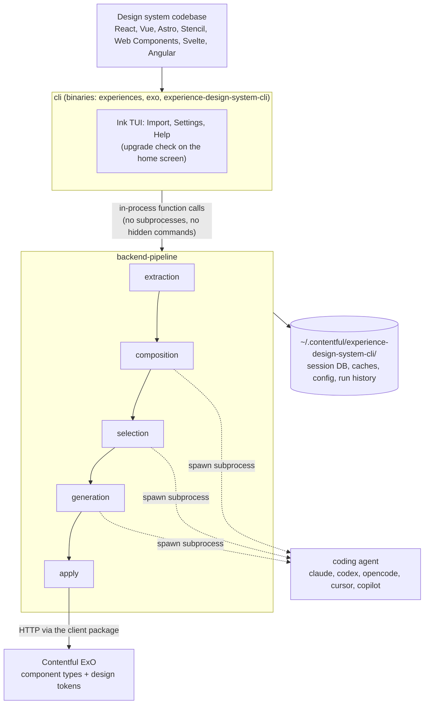
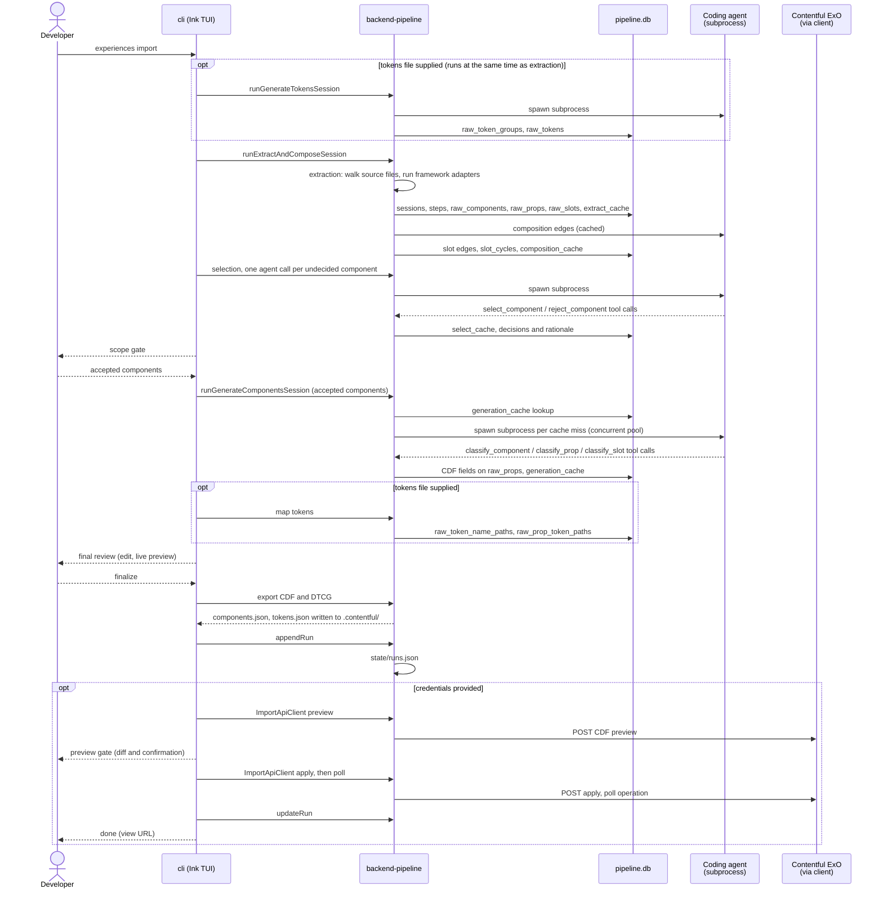

# Architecture

## Overview

An Nx monorepo with four packages. The CLI is the developer-facing ingestion tool: run it against a component library to produce curated, validated artifacts, then push them into Contentful Experience Orchestration (ExO) from the terminal.

| Package                                                 | Purpose                                                                                                                                                              |
| ------------------------------------------------------- | -------------------------------------------------------------------------------------------------------------------------------------------------------------------- |
| `@contentful/experience-design-system-cli`              | The published CLI: an Ink TUI (`experiences import`, or bare `experiences`). Owns screens and user interaction, and calls the backend pipeline in-process            |
| `@contentful/experience-design-system-backend-pipeline` | All pipeline logic (extraction, composition, selection, generation, apply), persistence (session database, caches, run history, credentials), agent invocation, analytics |
| `@contentful/experience-design-system-client`           | Generated API client for the Experience Design System Integrations API (from `openapi.json`), used by the apply step                                                 |
| `@contentful/experience-design-system-types`            | Shared types, Zod schemas and validation for CDF and DTCG, the sources-API shapes, and the `ImportHandoff` type passed between wizard stages                         |

## System Context



`experience-design-system-types` is imported by both the CLI and the backend pipeline. The CLI has one command, `experiences import` (the default); everything else happens in TUI screens.

## Packages

### `experience-design-system-cli`

The only package users install. `bin/cli.js` loads `dist/index.js`; `program.ts` builds the `commander` program (`src/commands/import.ts` registers the default command); `app.tsx` renders the TUI.

The TUI lives under `src/tui/`: `home/` (menu, version and upgrade check), `import/`, `settings/` (agents, project, debug mode, analytics opt-in) and `help/`. The import wizard is a numbered series of step folders in `src/tui/import/steps/`:

| Folder               | Screen                                                                           | Both | Components | Tokens |
| -------------------- | -------------------------------------------------------------------------------- | :--: | :--------: | :----: |
| `00-preflight`       | Choose what to import: tokens and components, components only, or tokens only   |  ✓   |     ✓      |   ✓    |
| `01-welcome`         | Welcome and project folder                                                       |  ✓   |     ✓      |   –    |
| `02-token-input`     | Tokens file                                                                      |  ✓   |     –      |   ✓    |
| `03-path-validation` | Validates the project path and scans its files                                   |  ✓   |     ✓      |   –    |
| `04-credentials`     | Collects and validates Contentful credentials; continues only once they validate |  ✓   |     ✓      |   ✓    |
| `05-token-review`    | Reviews generated tokens                                                         |  –   |     –      |   ✓    |
| `06-extraction`      | Runs extraction, composition and selection                                       |  ✓   |     ✓      |   –    |
| `07-scope-gate`      | The human gate: accept or reject components                                      |  ✓   |     ✓      |   –    |
| `08-generation`      | Runs generation, then token mapping when tokens were supplied                    |  ✓   |     ✓      |   –    |
| `09-review`          | Edits generated definitions with rationale panels and a live preview             |  ✓   |     ✓      |   –    |
| `10-flow`            | Save, preview, push and done (`flow/save.ts`, `flow/preview.ts`, `flow/push.ts`) |  ✓   |     ✓      |   ✓    |

Columns are the three import choices; the screens run in folder order. A tokens-only import generates its tokens (`run-generate-tokens-session`) after the credentials, and reviews them in `05-token-review`.

Each step folder wraps a call into the backend pipeline (`logic.ts`, `run.ts`) with Ink components (`screen.tsx`, `use-*.ts`). The CLI has no extraction, agent-invocation or HTTP code of its own. For TUI guidelines see `packages/experience-design-system-cli/DSI_TUI_ARCHITECTURE.md`.

**Key dependencies:** `ink` 5 and `react` 18 (renderer), `commander`, `semver` (version check), `typescript` (a runtime dependency, because customer sources are compiled at run time), plus the backend-pipeline and types packages.

### `experience-design-system-backend-pipeline`

Everything the import does that is not drawing a screen. The public API is the barrel `src/index.ts`; the CLI imports only from the package name.

```
packages/experience-design-system-backend-pipeline/
├── prompts/composition-edges.md   composition agent prompt
└── src/
    ├── steps/                     one folder per step, each with its own AGENTS.md
    │   ├── extraction/src/        step 1: per-framework extractors (ts-morph and SFC compilers)
    │   ├── composition/src/       step 2: parent/child edges, slot graph, cycle detection
    │   ├── selection/src/         step 3: agent decides which components belong; review helpers
    │   ├── generation/src/        step 4: agent produces CDF entries; token mapping; CDF/DTCG export
    │   ├── apply/src/             step 5: preview, apply and poll against the sources API
    │   └── shared/                CDF and DTCG validators, shared helpers
    ├── orchestrators/             multi-step sessions the CLI calls
    │   ├── run-extract-and-compose-session/
    │   ├── run-generate-tokens-session/
    │   └── run-generate-components-session/
    ├── agents/                    agent invocation, prompt building, tool-call parsers, skill files
    ├── persistence/src/           session DB, caches, run history, config and credentials, review sessions
    └── analytics/                 Segment client and command event tracking
```

Entry points (under `src/`):

- **Extraction:** `steps/extraction/src/controller/extract-components-endpoint.ts`; extractors in `steps/extraction/src/framework-adapters/` (react, vue, vue-tsx, astro, stencil, web-components, svelte, angular).
- **Selection:** `steps/selection/src/controller/select-components-endpoint.ts`.
- **Generation:** `steps/generation/src/controller/generate-cdf-components-endpoint.ts`; token mapping in `controller/map-tokens/`; writing `components.json` and `tokens.json` in `controller/export/`.
- **Apply:** `steps/apply/src/controller/endpoint/apply-components-endpoint.ts`; the HTTP wrapper (retry, polling) is `helpers/api-client/api-client.ts`.
- **Orchestration:** `orchestrators/*/run-*-session.ts` tie steps, the session database and the caches together.

**Key dependencies:** `ts-morph` (compiles customer sources at run time), `@vue/compiler-sfc` and `svelte` (SFC parsing), `node:sqlite` (`DatabaseSync`), `zod`, `ajv`, `contentful-management`, `@segment/analytics-node`, and the client and types packages.

### `experience-design-system-client`

TypeScript client for the Integrations API, generated from `openapi.json` with `@hey-api/openapi-ts` (`pnpm codegen`; script in `bin/generate.ts`, output in `src/generated/`). Its only consumer is the apply step's `ApiClient`.

### `experience-design-system-types`

CDF and DTCG types, Zod schemas and validators (`src/cdf/`, `src/dtcg/`), the sources-API shapes (`src/sources-api/`), the property contract (`src/property-contract/`), and `ImportHandoff` (`src/handoff/`, exported as `.../handoff`), which carries what the earlier wizard stages produced into review, save, preview and push. Published separately and consumed by the CLI, the backend pipeline and customer codebases.

## Pipeline Steps and Where State Lives

| Step | Name        | Code (under `backend-pipeline/src/`)                                       | Reads                                 | Writes                                                                                |
| ---- | ----------- | -------------------------------------------------------------------------- | ------------------------------------- | ------------------------------------------------------------------------------------- |
| 1    | Extraction  | `steps/extraction`, run by `run-extract-and-compose-session`               | Customer source files                 | `raw_components`, `raw_props`, `raw_slots`, `scanned_files`, `extract_cache`          |
| 2    | Composition | `steps/composition`, run by `run-extract-and-compose-session`              | Extracted components, source excerpts | Slot wiring on `raw_slots`, `slot_cycles`, `composition_cache`                        |
| 3    | Selection   | `steps/selection`, called from the CLI's `06-extraction/selection.ts`      | Extracted components                  | Accept/reject decisions with rationale, `select_cache`, review state under `reviews/` |
| 4    | Generation  | `steps/generation`, run by `run-generate-components-session`               | Accepted components, tokens           | CDF fields on `raw_props` / `raw_components`, `generation_cache`; files on save       |
| 5    | Apply       | `steps/apply`, driven by the CLI's `10-flow/flow/preview.ts` and `push.ts` | The saved CDF document                | Run record update; calls the sources API                                              |

Token generation (`run-generate-tokens-session`) is an optional branch that runs alongside extraction when the user supplies a tokens file (a tokens-only import runs it alone). It stores DTCG groups and leaves in `raw_token_groups` and `raw_tokens`. Token mapping runs after generation, in `steps/generation/src/controller/map-tokens/`.

### On-disk state

All locations come from `configRoot()` (`persistence/src/session/helpers/config-root.ts`): `~/.contentful/experience-design-system-cli/`, overridable with `EDS_HOME`.

| Path                     | Contents                                                                                                                                                    | Code (under `persistence/src/`)                 |
| ------------------------ | ----------------------------------------------------------------------------------------------------------------------------------------------------------- | ----------------------------------------------- |
| `pipeline.db`            | SQLite session database: sessions, step state, extracted and token data, all caches (`EDS_PIPELINE_DB_PATH` overrides the path)                             | `session/repositories/db.ts`                    |
| `config.json`            | Credentials and settings: agent and project preferences, debug mode, analytics opt-in (mode 0600)                                                           | `credentials/`, `session/helpers/config-root.ts` |
| `state/runs.json`        | One record per import run, appended by the CLI (`appendRun`) and updated after a push (`updateRun`)                                                         | `runs/`                                         |
| `reviews/`               | Per-session review state (`current-review-state.json`) for the scope gate and final review (`EDS_REVIEW_ARTIFACTS_DIR` overrides)                           | `review-session/`                               |
| `<project>/.contentful/` | The saved `components.json` and `tokens.json`. With Debug Mode on they go in a per-session folder, next to the debug logs and, after an error, their zip     | CLI: `help/file-locations.ts`, `10-flow/flow/save.ts` |

`DatabaseSync` is used throughout: synchronous writes keep the database consistent when a signal or uncaught exception arrives. Schema creation and in-place migrations are in `db.ts`.

Main tables in `pipeline.db`:

- `sessions`, `steps`: one session per import; one `steps` row per pipeline command, with status, inputs, outputs and error.
- `raw_components`, `raw_props`, `raw_prop_allowed_values`, `raw_slots`, `raw_slot_allowed_components`: the extraction output, later enriched with generated CDF fields (`cdf_type`, `cdf_category`, `cdf_token_kind`, `description`).
- `raw_token_groups`, `raw_tokens`: the session's DTCG input tokens.
- `raw_prop_token_paths`, `raw_token_name_paths`: token-mapping sidecars. The first holds the ordered paths behind `$token.allowed` (source `agent` or `review`; review wins). The second maps an extracted source reference to a canonical DTCG path.
- `scanned_files`, `slot_cycles`: files seen by extraction, and detected slot cycles with a suggested break edge.
- `extract_cache`, `composition_cache`, `select_cache`, `generation_cache`: content-hash caches, also keyed by CLI version (and by prompt hash for selection and generation). Unchanged inputs skip agent calls; a new CLI version or prompt invalidates them.

## Data Formats

Generated component attempts pass preflight before their tool calls are committed or cached: classifications must use supported types and categories, properties and slots must exist in the extracted component, allowed-component references must belong to the generation allowlist, and the projected CDF must pass the shared schema validator. A rejected attempt is rolled back and immediately regenerated with its validation errors in the prompt, within the existing two-attempt limit. Exhausted preflight failures do not stop the batch or prevent review: affected components carry warning markers and their generation errors into review, including when no definition was committed. Rejected output is never cached. Cycle checks remain in review; unresolved token kinds retain the existing mapping and document-repair behavior.

The backend's `runImportGeneration` owns scope-decision persistence, authentication checks, generation continuation policy, prompt preparation, token mapping, and the generation handoff. It emits structured progress events; the CLI translates them into terminal text and progress rows. The backend review-session API loads definitions, tokens and cycles, merges generation issues, supplies missing review entries, persists edits, refreshes blocking cycles, and finalizes review decisions. The CLI owns display sorting, warning colors and copy, layout, input handling, and local undo/redo state.

### RawComponentDefinition (extraction output)

Defined in `packages/experience-design-system-backend-pipeline/src/steps/extraction/src/types/component.ts`. Produced by extraction, stored in `pipeline.db`, consumed by selection and generation. Abridged:

```typescript
interface RawComponentDefinition {
  name: string; // PascalCase component name
  source: string; // absolute path to source file
  framework: "react" | "next" | "vue" | "astro" | "web-component" | "stencil" | "svelte" | "angular";
  props: RawPropDefinition[];
  slots: RawSlotDefinition[];
}

interface RawPropDefinition {
  name: string;
  type: string; // TypeScript type string
  required: boolean;
  category?: "content" | "design" | "state";
  defaultValue?: string;
  allowedValues?: string[]; // for enum / union types
  description?: string;
  tokenReference?: string; // e.g. "color.brand.primary"
}

interface RawSlotDefinition {
  name: string;
  isDefault: boolean; // true = children slot
  description?: string;
  allowedComponents?: string[];
}
```

### CDF (Component Definition Format)

The finalized format for ExO import. Types and Zod schemas are in `packages/experience-design-system-types/src/cdf/`. Generation produces it, `validateCDFFile` (`backend-pipeline/src/steps/shared/cdf/validators/`) validates it, and the apply step sends it. CDF is the manifest: components and design tokens travel in one document (see `docs/decisions/0001-cdf-is-the-manifest.md`). Abridged:

```typescript
interface CDFComponentEntry {
  $type: "component";
  $description?: string;
  $properties: Record<string, CDFPropertyDefinition>;
  $slots?: Record<string, CDFSlotDefinition>;
}

interface CDFPropertyDefinition {
  $type: CDFPropertyType; // 'string' | 'richtext' | 'number' | 'media' | 'link' | 'enum' | 'token' | 'boolean'
  $category: CDFPropertyCategory; // 'content' | 'design' | 'state' | 'unattached'
  $description?: string;
  $required?: boolean;
  $default?: unknown;
  $values?: string[];
  "$token.kind"?: string;
  "$token.allowed"?: string[]; // restricted DTCG paths; omitted for unrestricted token props
}
```

For design-category token properties, extraction stores the raw default in `raw_props.default_value` and token mapping never rewrites it. Mapping resolves `tokenReference` (else the raw default) to a canonical DTCG path when it matches exactly or has one token-kind-compatible normalized terminal-member match, and stores it in `raw_token_name_paths`. When CDF is projected, that path becomes `$default`; otherwise the raw default stays. The agent may write reviewed-compatible DTCG paths to `$token.allowed`; an empty or absent restriction leaves the property unrestricted.

### DTCG (W3C Design Token Format)

Token files following the W3C DTCG spec (`packages/experience-design-system-types/src/dtcg/`). Supplied by the user or produced by token generation, and merged into the CDF document on save and apply.

## Data Flow



Agents are always invoked as subprocesses (`backend-pipeline/src/agents/invoker/create-local-cli-agent-invoker.ts`), never through an agent SDK or API. This is a firm constraint.

## Agents and Prompts

The backend pipeline owns agent invocation, in `packages/experience-design-system-backend-pipeline/src/agents/`:

- **Agent choice:** `claude`, `codex`, `opencode`, `cursor` or `copilot` (`agents/types/agent-name.ts`), optionally with a model (`claude:sonnet`). The agent comes from the preferences saved in the TUI settings (`config.json`), then the built-in default. `EDS_AGENT_MODEL_<AGENT>` sets a per-agent model, and `EDS_AGENT_BINARY_<AGENT>` points the pipeline at a different binary (the end-to-end tests use it for a fake `claude`).
- **Skill files:** markdown instructions in `agents/skills/selection/select-components.md` and `agents/skills/generation/` (`generate-components.md`, `generate-tokens.md`, `map-tokens.md`). The composition prompt is `prompts/composition-edges.md` at the package root.
- **Prompt building:** `agents/prompts/build-prompt.ts` combines a skill file with a runtime preamble (mode, inline JSON of the component data, optional file paths, the output protocol). Raw components are passed inline, not as a file path.
- **Output protocol:** the agent prints one JSON tool-call object per line on stdout; the parsers are in `agents/parsers/`.

## Extraction

Each framework has an adapter in `steps/extraction/src/framework-adapters/` that walks source files and produces `RawComponentDefinition`s. `shared/` holds helpers reused across adapters, including worker-based per-file extraction. `helpers/pre-classify.ts` assigns provisional content/design/state categories; `helpers/evidence/` and `helpers/quality/` support composition and review.

React (`react/extract-react-components.ts`, with shared TSX logic in `shared/extract-tsx-components.ts`): find exported PascalCase declarations, unwrap `FC<P>`, `forwardRef` and `PropsWithChildren<P>` to the props type, enumerate and pre-classify the props, and detect slots (`children`, render props).

**DOM attribute props.** React components often extend `HTMLAttributes<T>`, `ButtonHTMLAttributes<T>`, `SVGProps<T>` and similar, and full TypeScript expansion yields hundreds of props. A curated allowlist of wrapper types (`EXPANDABLE_DOM_ATTRIBUTE_TYPE_NAMES`) limits which are surfaced. Find it with `grep -rn EXPANDABLE_DOM_ATTRIBUTE_TYPE_NAMES packages/experience-design-system-backend-pipeline/src/steps/extraction/src`.

## The Import Wizard

`experiences import` needs an interactive terminal and has no headless mode. Which screens run depends on the choice made in `00-preflight` (see the table under `experience-design-system-cli`).

A single human gate, the scope gate, comes before generation. With tokens and a terminal at least 100 columns wide it shows components and tokens in two columns, otherwise in one. Final review edits names, `$description`, `$default`, `$allowedComponents` and `$values` inline, with rationale and source panels, and re-runs the live preview after each save. After review the wizard saves one combined CDF, then previews and pushes it.

The Credentials screen has no skip option. `ImportHandoff` still carries `credentialsSkipped` and the flow still honours it (files are saved, the preview is bypassed and push is refused), but nothing sets it to `true` today.

**Apply.** The sources-API calls are in `steps/apply/src/` (see its `AGENTS.md`): build the CDF with `buildCDF`, `POST …/design_systems/imports/preview`, check for breaking changes, `POST …/imports/apply`, then poll `GET …/imports/apply/{operationId}`. Transient 5xx responses on preview and poll are retried; the apply request is not retried once dispatched. The CLI drives these calls from `10-flow/flow/preview.ts`, `10-flow/flow/push.ts` and the live preview in `09-review/run-live-preview.ts`, through `ImportApiClient`.

## Debug Logs and the Support Zip

Every import step writes a markdown debug log through `startDebugRun` and `finishDebugRun` (`packages/experience-design-system-cli/src/tui/debug-store.ts`), one file per run of a step, in `<base>/.contentful/<date>-session-<n>/debug/import/<NN-step>/`. Logs are written only while Debug Mode is on (the default) and deleted after the retention setting (7, 14 or 30 days). Only `.md` files under `debug/` are touched.

When a step ends on the shared error screen, `src/tui/support-bundle.ts` zips the session's logs into `<date>-session-<n>-debug-logs.zip`, next to `debug/`, and the screen shows where it is. The user sends that file to Contentful support. The zip sits outside `debug/`, so the cleanup leaves it alone.

## End-to-End Tests

`packages/experience-design-system-cli/test/e2e/` drives the real app with keystrokes through each import choice, from the first screen to Done. Only the agent and Contentful are fake: `EDS_AGENT_BINARY_CLAUDE` points the pipeline at a fake `claude` script, and Contentful is a local server whose address is typed in as the API host. Each scenario checks the saved CDF against the schema.

## Further Reading

- `packages/experience-design-system-cli/DSI_TUI_ARCHITECTURE.md`: TUI architecture and screen guidelines
- `packages/experience-design-system-cli/.claude/skills/ink-api/SKILL.md` and `ink-ui/SKILL.md`: Ink API and UI component reference
- `packages/experience-design-system-backend-pipeline/src/steps/*/src/AGENTS.md`: per-step contracts (input, output, cache, external calls)
