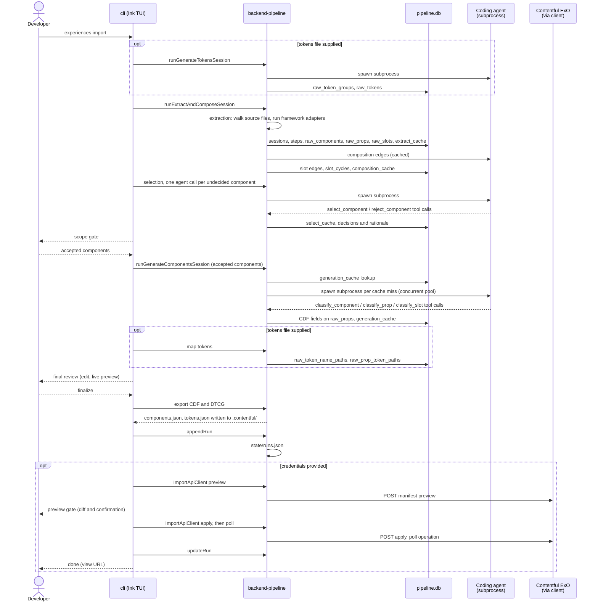

# Architecture

## Overview

The Experience Design System SDK is an Nx monorepo that ships four packages:

| Package                                                 | Purpose                                                                                                                                                                          |
| ------------------------------------------------------- | -------------------------------------------------------------------------------------------------------------------------------------------------------------------------------- |
| `@contentful/experience-design-system-cli`              | The published CLI: an Ink TUI (opened by `experiences import` or bare `experiences`). It owns screens and user interaction and calls the backend pipeline in-process             |
| `@contentful/experience-design-system-backend-pipeline` | All pipeline logic: extraction, composition, selection, generation and apply, plus persistence (session database, caches, run history, credentials), agent invocation, analytics |
| `@contentful/experience-design-system-client`           | Generated API client for the Experience Design System Integrations API (from `openapi.json`); used by the backend pipeline's apply step                                          |
| `@contentful/experience-design-system-types`            | Shared TypeScript types, Zod schemas and validation logic for CDF and DTCG, the sources-API shapes, and the `ImportHandoff` type passed between wizard stages                    |

The CLI is the developer-facing ingestion tool in the design system import pipeline. A developer runs it against their component library to produce curated, validated artifacts, then pushes them directly into Contentful Experience Orchestration (ExO) from their terminal.

---

## System Context

```
Design system codebase
  (React / Vue / Astro / Stencil / Web Components / Svelte / Angular)
        │
        ▼
  experience-design-system-cli   (binaries: experiences | exo | experience-design-system-cli)
    Ink TUI: Import, Settings, Help (Upgrade check on the home screen)
        │  in-process function calls (no subprocesses, no hidden commands)
        ▼
  experience-design-system-backend-pipeline
    extraction → composition → selection → generation → apply
        │                │                                │
        │                │ spawns coding-agent            │ HTTP via
        │                ▼ subprocesses                  ▼ experience-design-system-client
        │         claude / codex / opencode /         Contentful ExO
        │         cursor / copilot                    (component types + design tokens)
        ▼
  ~/.contentful/experience-design-system-cli/   (session DB, caches, config, run history)
```

`experience-design-system-types` is imported by both the CLI and the backend pipeline. The CLI has a single command, `experiences import` (the default, so bare `experiences` is the same), which opens the TUI; everything else happens in TUI screens.

---

## Packages

### `experience-design-system-cli`

The published package and the only one users install. `bin/cli.js` loads `dist/index.js`; `program.ts` builds the `commander` program (`src/commands/import.ts` registers the default command with `--agent`, `--prompt <stage=value>` and a repo-checkout-only `--watch`); `app.tsx` renders the TUI.

The TUI lives under `src/tui/`: `home/` (menu and version/upgrade check), `import/`, `settings/` (agents, project, debug mode, analytics opt-in) and `help/`. The import wizard is a numbered series of step folders in `src/tui/import/steps/`:

| Folder               | Screen                                                                                       |
| -------------------- | -------------------------------------------------------------------------------------------- |
| `00-preflight`       | Choose what to generate: tokens and components, tokens only, or components only              |
| `01-welcome`         | Welcome                                                                                      |
| `02-token-input`     | Tokens file                                                                                  |
| `03-path-validation` | Validates the project path and scans its files                                               |
| `04-credentials`     | Collects and validates Contentful credentials (skip means files are saved, not pushed)       |
| `05-token-review`    | Reviews generated tokens                                                                     |
| `06-extraction`      | Runs extraction, composition and selection                                                   |
| `07-scope-gate`      | The human gate: accept or reject components                                                  |
| `08-generation`      | Runs generation, then token mapping when tokens were supplied                                |
| `09-review`          | Edits generated definitions with rationale panels and a live preview                         |
| `10-flow`            | Save, preview, push and done (`flow/save.ts`, `flow/preview.ts`, `flow/push.ts`, `screens/`) |

Each step folder wraps a call into the backend pipeline (`logic.ts`, `run.ts`) with Ink components (`screen.tsx`, `use-*.ts`). The CLI contains no extraction, agent-invocation or HTTP code of its own.

**See `packages/experience-design-system-cli/DSI_TUI_ARCHITECTURE.md` for TUI architecture and component guidelines.**

**Key dependencies:** `ink` 5 and `react` 18 (terminal renderer), `commander` (argument parsing), `semver` (version check), plus the backend-pipeline and types workspace packages.

### `experience-design-system-backend-pipeline`

Everything the import does that is not drawing a screen. The public API is the single barrel `src/index.ts`; the CLI imports only from `@contentful/experience-design-system-backend-pipeline`.

```
packages/experience-design-system-backend-pipeline/
├── prompts/composition-edges.md   composition agent prompt
└── src/
    ├── steps/                     one folder per step, each with its own AGENTS.md
    │   ├── extraction/src/        step 1: per-framework extractors (ts-morph and SFC compilers)
    │   ├── composition/src/       step 2: parent/child edges, slot graph, cycle detection
    │   ├── selection/src/         step 3: agent decides which components belong; review helpers
    │   ├── generation/src/        step 4: agent produces CDF entries; token mapping; CDF/DTCG export
    │   ├── apply/src/             step 5: preview, apply and poll against the sources API
    │   └── shared/                CDF and DTCG validators, shared helpers
    ├── orchestrators/             multi-step sessions the CLI calls
    │   ├── run-extract-and-compose-session/
    │   ├── run-generate-tokens-session/
    │   └── run-generate-components-session/
    ├── agents/                    agent invocation, prompt building, tool-call parsers, skill files
    ├── persistence/src/           session DB, caches, run history, config and credentials, review sessions
    └── analytics/                 Segment client and command event tracking
```

Where to look (paths relative to `packages/experience-design-system-backend-pipeline/src/`):

- **Extraction**: `steps/extraction/src/controller/extract-components-endpoint.ts` is the entry point; the per-framework extractors are in `steps/extraction/src/framework-adapters/` (react, vue, vue-tsx, astro, stencil, web-components, svelte, angular).
- **Selection**: `steps/selection/src/controller/select-components-endpoint.ts`.
- **Generation**: `steps/generation/src/controller/generate-cdf-components-endpoint.ts`; token mapping in `steps/generation/src/controller/map-tokens/`; writing `components.json` / `tokens.json` in `steps/generation/src/controller/export/`.
- **Apply**: `steps/apply/src/controller/endpoint/apply-components-endpoint.ts`; the HTTP wrapper (retry, polling) is `steps/apply/src/helpers/api-client/api-client.ts`.
- **Orchestration**: `orchestrators/*/run-*-session.ts` tie steps, the session database and the caches together.

**Key dependencies:** `ts-morph` and `typescript` (static analysis; the package compiles customer sources at run time), `@vue/compiler-sfc` and `svelte` (SFC parsing), `node:sqlite` (`DatabaseSync`, built-in synchronous SQLite), `zod`, `ajv`, `contentful-management`, `@segment/analytics-node`, and the client and types packages.

### `experience-design-system-client`

Generated TypeScript client for the Experience Design System Integrations API, generated from `openapi.json` via `@hey-api/openapi-ts` (`pnpm codegen`, script in `bin/generate.ts`; output in `src/generated/`). Its only consumer is the backend pipeline's `ApiClient` in `steps/apply/src/helpers/api-client/`.

### `experience-design-system-types`

CDF and DTCG type definitions, Zod schemas and validation utilities (`src/cdf/`, `src/dtcg/`), the sources-API shapes (`src/sources-api/`), the property contract (`src/property-contract/`), and `ImportHandoff` (`src/handoff/`, exported as `@contentful/experience-design-system-types/handoff`), which carries what the earlier wizard stages produced into review, save, preview and push. Published as a separate package and consumed by the CLI, the backend pipeline and customer codebases.

---

## Pipeline Steps and Where State Lives

| Step | Name        | Code (under `backend-pipeline/src/`)                                       | Reads                                 | Writes                                                                                |
| ---- | ----------- | -------------------------------------------------------------------------- | ------------------------------------- | ------------------------------------------------------------------------------------- |
| 1    | Extraction  | `steps/extraction`, run by `run-extract-and-compose-session`               | Customer source files                 | `raw_components`, `raw_props`, `raw_slots`, `scanned_files`, `extract_cache`          |
| 2    | Composition | `steps/composition`, run by `run-extract-and-compose-session`              | Extracted components, source excerpts | Slot wiring on `raw_slots`, `slot_cycles`, `composition_cache`                        |
| 3    | Selection   | `steps/selection`, called from the CLI's `06-extraction/selection.ts`      | Extracted components                  | Accept/reject decisions with rationale, `select_cache`, review state under `reviews/` |
| 4    | Generation  | `steps/generation`, run by `run-generate-components-session`               | Accepted components, tokens           | CDF fields on `raw_props` / `raw_components`, `generation_cache`; files on save       |
| 5    | Apply       | `steps/apply`, driven by the CLI's `10-flow/flow/preview.ts` and `push.ts` | The saved CDF document                | Run record update; calls the sources API                                              |

Token generation (`run-generate-tokens-session`) is an optional branch that runs before extraction when the user supplies a tokens file; it stores DTCG groups and leaves in `raw_token_groups` and `raw_tokens`. Token mapping runs after generation in `steps/generation/src/controller/map-tokens/`.

### On-disk state

All locations are resolved by `configRoot()` in `packages/experience-design-system-backend-pipeline/src/persistence/src/session/helpers/config-root.ts`: `~/.contentful/experience-design-system-cli/`, overridable with `EDS_HOME`.

| Path                     | Contents                                                                                                                                 | Code (under `backend-pipeline/src/persistence/src/`)          |
| ------------------------ | ---------------------------------------------------------------------------------------------------------------------------------------- | ------------------------------------------------------------- |
| `pipeline.db`            | SQLite session database: sessions, step state, raw extracted data, token data and all caches (`EDS_PIPELINE_DB_PATH` overrides the path) | `session/repositories/db.ts`                                  |
| `config.json`            | Credentials and settings: agent and project preferences, debug mode, analytics opt-in (mode 0600)                                        | `credentials/`, `session/helpers/config-root.ts`              |
| `state/runs.json`        | One record per import run: appended by the CLI (`appendRun`), updated after a push (`updateRun`)                                         | `runs/`                                                       |
| `reviews/`               | Per-session review state (`current-review-state.json`) for the scope gate and final review (`EDS_REVIEW_ARTIFACTS_DIR` overrides)        | `review-session/`                                             |
| `<project>/.contentful/` | The saved `components.json` and `tokens.json`. With Debug Mode on they go in a per-terminal-session folder, next to the debug logs       | CLI: `src/tui/help/file-locations.ts`, `10-flow/flow/save.ts` |

`DatabaseSync` is used throughout. Synchronous writes are safe from SIGINT and uncaught exceptions without async ceremony, so the database is consistent at the moment of a signal. Schema creation and in-place migrations are in `db.ts`.

Main tables in `pipeline.db`:

- `sessions`, `steps`: one session per import; one `steps` row per pipeline command with status, inputs, outputs and error.
- `raw_components`, `raw_props`, `raw_prop_allowed_values`, `raw_slots`, `raw_slot_allowed_components`: the extraction output, later enriched with generated CDF fields (`cdf_type`, `cdf_category`, `cdf_token_kind`, `description`).
- `raw_token_groups`, `raw_tokens`: DTCG input tokens for the session.
- `raw_prop_token_paths`, `raw_token_name_paths`: token-mapping sidecars. The first holds the ordered paths behind `$token.allowed` (source `agent` or `review`; review decisions win). The second maps an extracted source reference to a canonical DTCG path. Both preserve raw extraction while the CDF projection is built.
- `scanned_files`, `slot_cycles`: files seen by extraction, and detected slot cycles with a suggested break edge.
- `extract_cache`, `composition_cache`, `select_cache`, `generation_cache`: content-hash caches. Entries are also keyed by CLI version (and by prompt hash for selection and generation), so unchanged inputs skip agent calls and a new CLI version or prompt invalidates them.

---

## Data Formats

### RawComponentDefinition (extraction output)

Defined in `packages/experience-design-system-backend-pipeline/src/steps/extraction/src/types/component.ts`. Produced by extraction, stored in `pipeline.db`, consumed by selection and generation. Abridged:

```typescript
interface RawComponentDefinition {
  name: string; // PascalCase component name
  source: string; // absolute path to source file
  framework: "react" | "next" | "vue" | "astro" | "web-component" | "stencil" | "svelte" | "angular";
  props: RawPropDefinition[];
  slots: RawSlotDefinition[];
}

interface RawPropDefinition {
  name: string;
  type: string; // TypeScript type string
  required: boolean;
  category?: "content" | "design" | "state";
  defaultValue?: string;
  allowedValues?: string[]; // for enum / union types
  description?: string;
  tokenReference?: string; // e.g. "color.brand.primary"
}

interface RawSlotDefinition {
  name: string;
  isDefault: boolean; // true = children slot
  description?: string;
  allowedComponents?: string[];
}
```

### CDF (Component Definition Format)

The finalized format for Contentful ExO import. Types and Zod schemas are in `packages/experience-design-system-types/src/cdf/`. Produced by generation, validated by `validateCDFFile` (`backend-pipeline/src/steps/shared/cdf/validators/`) and sent by the apply step. CDF is the manifest: components and design tokens travel in one document (see `docs/decisions/0001-cdf-is-the-manifest.md`). Abridged:

```typescript
interface CDFComponentEntry {
  $type: "component";
  $description?: string;
  $properties: Record<string, CDFPropertyDefinition>;
  $slots?: Record<string, CDFSlotDefinition>;
}

interface CDFPropertyDefinition {
  $type: CDFPropertyType; // 'string' | 'richtext' | 'number' | 'media' | 'link' | 'enum' | 'token' | 'boolean'
  $category: CDFPropertyCategory; // 'content' | 'design' | 'state'
  $description?: string;
  $required?: boolean;
  $default?: unknown;
  $values?: string[];
  "$token.kind"?: string;
  "$token.allowed"?: string[]; // restricted DTCG paths; omitted for unrestricted token props
}
```

For design-category token properties, extraction stores the raw default in `raw_props.default_value` and token mapping does not rewrite it. Mapping resolves `tokenReference` when present, otherwise the raw default, to a canonical DTCG path when it is exact or has one token-kind-compatible normalized terminal-member match, and persists that in `raw_token_name_paths`. When CDF is projected, that path becomes `$default`; otherwise the raw extracted default is retained. The agentic part of the stage may write reviewed-compatible DTCG paths to `$token.allowed`; an empty or absent restriction leaves the property unrestricted.

### DTCG (W3C Design Token Format)

Design token files following the W3C DTCG spec (`packages/experience-design-system-types/src/dtcg/`). Supplied by the user or produced by token generation, and merged into the CDF document on save and apply.

---

## Data Flow



Agents are always invoked as subprocesses (`backend-pipeline/src/agents/invoker/create-local-cli-agent-invoker.ts`), never through an agent SDK or API. This is a firm constraint.

---

## Agents and Prompts

The backend pipeline owns agent invocation under `packages/experience-design-system-backend-pipeline/src/agents/`:

- **Agent choice**: `claude`, `codex`, `opencode`, `cursor` or `copilot` (`agents/types/agent-name.ts`), optionally with a model (`--agent claude:sonnet`). Resolution order is flag, then the agent preferences in `config.json`, then the built-in default; `EDS_AGENT_MODEL_<AGENT>` sets a per-agent model.
- **Skill files**: markdown instructions in `agents/skills/selection/select-components.md` and `agents/skills/generation/` (`generate-components.md`, `generate-tokens.md`, `map-tokens.md`); the composition prompt is `prompts/composition-edges.md` at the package root. `--prompt <stage=value>` overrides a stage prompt with a file or literal text.
- **Prompt building**: `agents/prompts/build-prompt.ts` combines a skill file with a runtime preamble (mode, inline JSON of the component data, optional file paths, the output protocol). Raw components are passed inline, not as a file path.
- **Output protocol**: the agent emits one JSON tool-call object per line on stdout. The parsers are in `agents/parsers/`.

---

## Extraction

Each framework has an adapter in `packages/experience-design-system-backend-pipeline/src/steps/extraction/src/framework-adapters/` that walks source files and produces `RawComponentDefinition`s. `shared/` holds helpers reused across adapters, including worker-based per-file extraction. `helpers/pre-classify.ts` assigns provisional content/design/state categories; `helpers/evidence/` and `helpers/quality/` support composition and review.

React path (`react/extract-react-components.ts`, with shared TSX logic in `shared/extract-tsx-components.ts`): find exported PascalCase declarations, unwrap `FC<P>`, `forwardRef` and `PropsWithChildren<P>` to the props type, enumerate props, pre-classify them, and detect slots (`children`, render props).

### DOM attribute prop surfacing

React components commonly extend `HTMLAttributes<T>`, `ButtonHTMLAttributes<T>`, `SVGProps<T>` and similar. Full TypeScript expansion produces hundreds of props, so the extractor uses a curated allowlist of DOM attribute wrapper types (`EXPANDABLE_DOM_ATTRIBUTE_TYPE_NAMES`) to restrict which props are surfaced. Find it with `grep -rn EXPANDABLE_DOM_ATTRIBUTE_TYPE_NAMES packages/experience-design-system-backend-pipeline/src/steps/extraction/src`.

---

## The Import Wizard

`experiences import` requires an interactive terminal and has no headless mode. It takes `--agent` and `--prompt <stage=value>`, and asks for the project and tokens file on its own screens.

The screens in `src/tui/import/steps/` run in order: preflight, welcome, token input, path validation, credentials, optional token review, extraction (with composition and selection), scope gate, generation, review, then save, preview, push and done in `10-flow`. A single human gate (the scope gate) precedes generation. Final review edits names, `$description`, `$default`, `$allowedComponents` and `$values` inline with rationale and source panels and re-runs the live preview after each save. After review the wizard always saves one combined CDF, then previews and pushes it unless credentials were skipped. Choosing skip on the Credentials screen sets `credentialsSkipped` in `ImportHandoff`, which saves files only: the preview is bypassed and push is refused.

### Apply

The sources-API contract is implemented in `packages/experience-design-system-backend-pipeline/src/steps/apply/src/`: build the CDF document (`buildCDF` from the types package), `POST /imports/preview`, check for breaking changes, `POST /imports`, then poll `GET /imports/operations/{operationId}` with backoff and `Retry-After` handling. Transient 5xx and 429 responses are retried on preview and poll; the apply request itself is not retried once dispatched. The CLI drives these calls from `10-flow/flow/preview.ts`, `10-flow/flow/push.ts` and the live preview in `09-review/run-live-preview.ts`, using `ImportApiClient` from the pipeline package.

---

## TUI Resources

The wizard renders Ink (React) component trees in a TTY. State uses React hooks, keyboard input uses Ink's `useInput`, and `NO_COLOR=1` suppresses ANSI color. The scope gate shows two columns at 100 or more terminal columns and one column below that.

- **`packages/experience-design-system-cli/DSI_TUI_ARCHITECTURE.md`**: architecture and screen guidelines
- **`packages/experience-design-system-cli/.claude/skills/ink-api/SKILL.md`**: Ink core API (Box, Text, colors, hooks)
- **`packages/experience-design-system-cli/.claude/skills/ink-ui/SKILL.md`**: Ink UI component reference
- **`packages/experience-design-system-backend-pipeline/src/steps/*/src/AGENTS.md`**: per-step contracts (input, output, cache, external calls)
