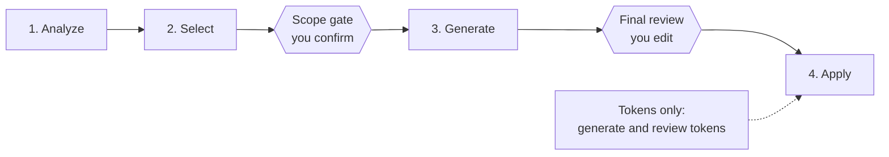

# Experience Design System SDK

> ⚠️ This feature is in Beta, APIs may be unstable

Contentful Experiences lets you compose pages and layouts from your own design system components. The `@contentful/experience-design-system-cli` imports your design system into Contentful. It extracts Component Type definitions from your local codebase and, if you have a design token file, generates design tokens from it. An AI coding agent then generates Component Definition Format (CDF) definitions, and the CLI pushes everything to your Contentful space.

Your codebase remains the single source of truth. The CLI analyzes your source files (`.tsx`, `.ts`, `.jsx`, `.js`, `.vue`, `.svelte`, `.astro`) with static analysis, then delegates property classification and CDF generation to the agent.

## Prerequisites

- **Node.js 24 or later.** To check, open a terminal and type `node -v`. If you see an error or a number lower than 24, install the "LTS" version from [nodejs.org](https://nodejs.org/en/download). The installer also gives you `npm`, which you need below.
- **A coding agent.** Install one of Claude Code, Codex, OpenCode, Cursor, or GitHub Copilot, sign in to it, and make sure you can start it by typing its command in your terminal.
- **Your Contentful space ID, environment ID, and a CMA token.** The space ID identifies the space you are importing into. The environment ID identifies the environment inside it (most spaces use `master`). A CMA token is a secret key that lets this tool make changes in that space; create one in Contentful under **Settings → CMA tokens**. The tool asks for all three while it runs. If your space is hosted in the EU, enter `api.eu.contentful.com` when it asks for the API host.

## Quick Start

### Install

```bash
npm install -g @contentful/experience-design-system-cli
```

To confirm the install worked, type `experiences --version`. It should print a version number.

The install adds three commands: `experiences`, `exo`, and `experience-design-system-cli`. All three do the same thing; this guide uses `experiences`. To build the tool from source instead, see the [contributing guide](https://github.com/contentful/experience-design-system-sdk-public/blob/development/CONTRIBUTING.md).

### Run

```bash
experiences import
```

This opens a full-screen guided wizard, so make your terminal window as large as you can first. Typing `experiences` with no command opens a home screen with **Import**, **Settings**, and **Help**. Use **Settings** to save your Contentful credentials and choose your coding agent, and **Import** to start the wizard.

The wizard first asks what you want to import, then asks only for what that choice needs:

| You choose                   | The wizard asks for                                                       |
| ---------------------------- | ------------------------------------------------------------------------- |
| Design tokens and components | Your project folder, a file of design tokens, and your Contentful details |
| Components only              | Your project folder and your Contentful details                           |
| Design tokens only           | A file of design tokens and your Contentful details                       |

After that it works through your components and tokens, you review the result, and it shows what will change in your space before sending anything to Contentful.

## How it works



| Stage    | What happens                                                                                                                              |
| -------- | ----------------------------------------------------------------------------------------------------------------------------------------- |
| Analyze  | Reads your source files and extracts every component: name, props, types, source location                                                |
| Select   | An AI agent keeps the components worth exposing (buttons, cards, layouts) and skips the rest (hooks, context providers, utilities)       |
| Generate | An AI agent says what each prop is for: content, a design token, or interactive state                                                     |
| Apply    | Saves a combined `components.json` for source control, shows a diff of what will change in your space, then pushes                        |

At the **scope gate** you confirm or override the selected list. In the **final review** you edit names, descriptions, defaults, allowed values, and slot constraints inline.

## Packages

| Package                                                                                                         | Description                                                                                       |
| --------------------------------------------------------------------------------------------------------------- | ------------------------------------------------------------------------------------------------- |
| [`@contentful/experience-design-system-cli`](packages/experience-design-system-cli/)                            | The CLI: interactive TUI and wizard to review, generate, validate, and push component definitions |
| [`@contentful/experience-design-system-backend-pipeline`](packages/experience-design-system-backend-pipeline/) | The logic behind the CLI: extraction, composition, selection, generation and apply                |
| [`@contentful/experience-design-system-client`](packages/experience-design-system-client/)                      | Generated client for the Experience Design System Integrations API                                |
| [`@contentful/experience-design-system-types`](packages/experience-design-system-types/)                        | Shared types and schemas for the CDF and DTCG data formats                                        |

## Settings and defaults

Two settings are **on** until you turn them off, both under **Settings** on the home screen.

### Usage analytics (Settings → Opt-in Analytics)

The CLI shares anonymous usage data by default: which commands are used and where imports succeed or fail. It never includes source code, file paths, credentials, or authored content. To turn it off, open **Settings → Opt-in Analytics** and press Enter or Space.

### Debug logging (Settings → Debug Mode)

The CLI writes a debug log for each screen by default, so there is something to share if you hit a problem. The CMA token is redacted. Logs are deleted after 30 days; under **Settings → Debug Mode** you can change that to 7 or 14 days, or turn logging off.

The logs go in a folder for each terminal session, `<base>/.contentful/<date>-session-<n>/debug`, next to the `tokens.json` and `components.json` each import saves. `<base>` is the **Root Project Directory** if you set one under **Settings → Configuration → Project**, otherwise the project you are importing. So **by default these folders are created inside your own project**. To keep them out, set a Root Project Directory somewhere else, or add `.contentful/` to your `.gitignore`.

With Debug Mode off, no logs are written and the saved files go in `<project>/.contentful/`. The **Help** screen shows where the current session writes its files.

## If an import fails

When a step fails, the error screen says so and saves a zip of that session's debug logs, then shows its full path: `<base>/.contentful/<date>-session-<n>/<date>-session-<n>-debug-logs.zip`.

Send that zip to Contentful support. It sits next to the `debug` folder, so the log cleanup does not delete it; delete it yourself when you no longer need it.

If Debug Mode is off there is nothing to zip. The error screen tells you to turn on Debug Mode under **Settings → Debug Mode**, run the import again, and send the zip it saves.
